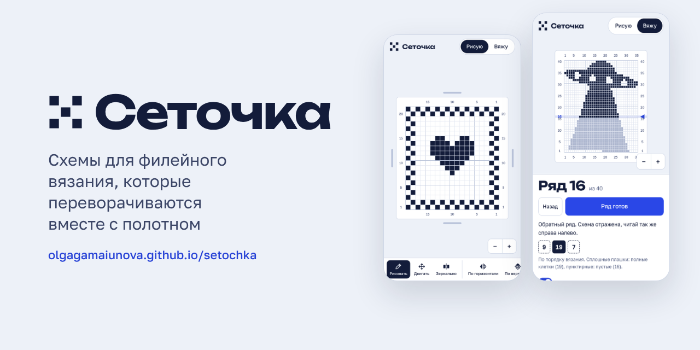
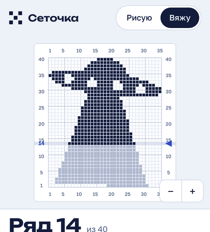
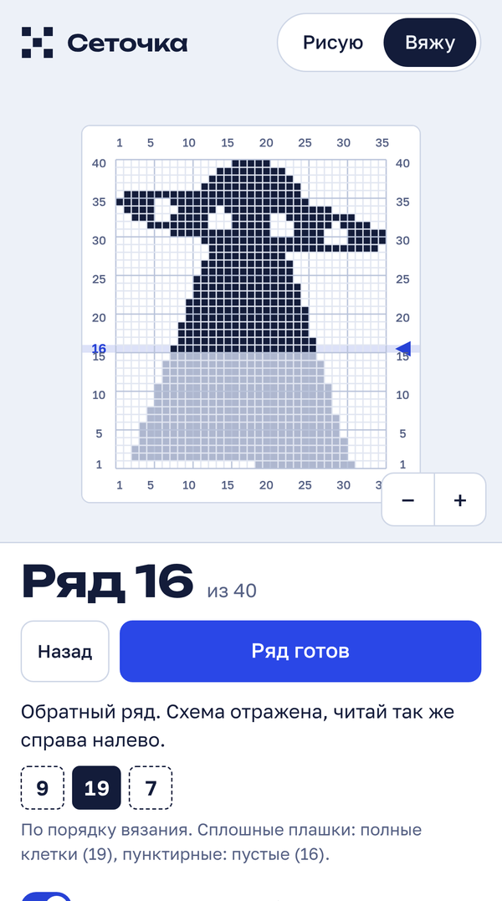
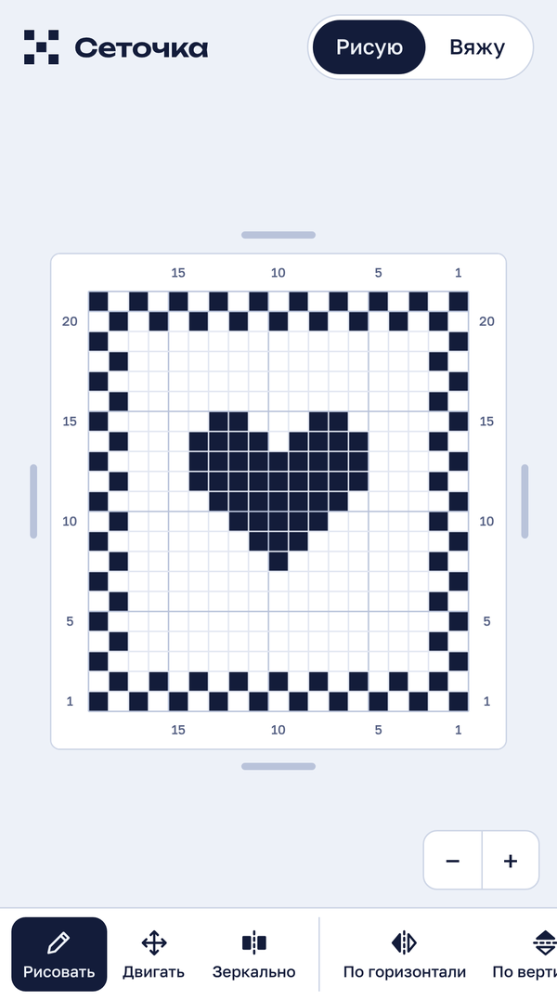
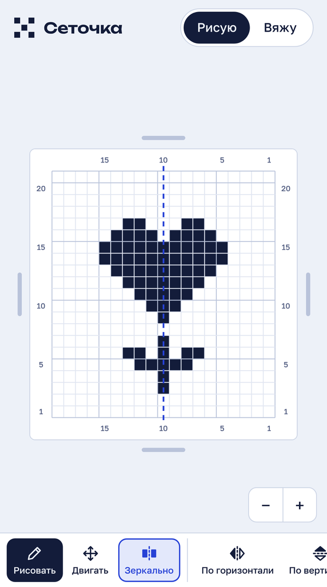
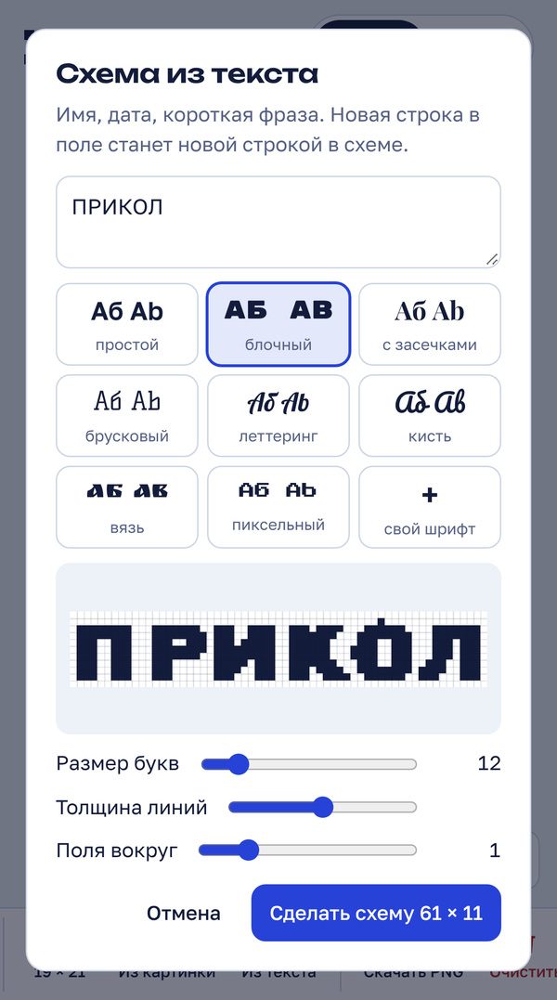
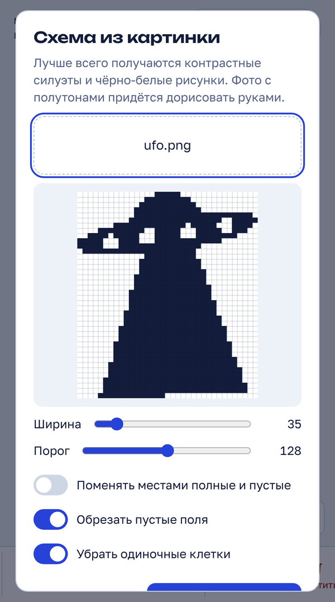

  

  <a href="https://olgagamaiunova.github.io/setochka/"><b>Открыть приложение</b></a>
  ·
  <a href="#english">English</a>

# Сеточка

Редактор схем для филейного вязания, который помогает прямо во время работы.

В филейке полотно переворачивают после каждого ряда, а схема остаётся на месте. Каждый второй ряд приходится читать задом наперёд и держать счёт клеток в голове. Сеточка переворачивает схему вместе с полотном, поэтому читать её всегда нужно в одну сторону.

  

## Как это работает

### Вяжу

Главный режим. Текущий ряд подсвечен, стрелка показывает, с какой стороны его начинать, а под схемой ряд уже разложен на счёт: 7 пустых, 19 полных, 9 пустых.

- На обратном ряду схема отражается сама, как полотно после поворота.
- Кнопка «Ряд готов» стоит на одном месте, её удобно нажимать с крючком в руке.
- Для левшей есть настройка «первый ряд слева направо».

### Рисую

| Рисовать по клеткам | Рисовать зеркально |
| :---: | :---: |
|  |  |
| Закрашивай и стирай клетки пальцем или мышкой. Есть отмена, отражение и инверсия. | Рисуешь с одной стороны от пунктира, с другой появляется то же самое. |

Размер полотна меняется прямо на схеме: тянешь за край, и рядом с курсором видно, сколько рядов или столбцов добавится и с какой стороны. Точный размер можно задать в окне «Размер».

### Схема из текста или картинки

| Из текста | Из картинки |
| :---: | :---: |
|  |  |
| Восемь шрифтов с латиницей и кириллицей или свой файл шрифта. Настраиваются размер букв, толщина линий и поля. | Порог подбирается автоматически, пустые поля обрезаются, одиночные клетки убираются. Лучше всего работают силуэты и контрастные рисунки. |

Готовую схему можно скачать в PNG.

## Запуск

Всё приложение лежит в одном файле `index.html`, сборка не нужна. Его можно открыть в браузере или выложить на GitHub Pages.

Схема сохраняется в браузере, на этом устройстве. Для шрифтов в «Схеме из текста» нужен интернет, остальное работает без него.

## Ограничения прототипа

- Одна схема за раз, без аккаунтов и синхронизации.
- Размер схемы до 400 × 400 клеток.
- Фотографии с полутонами превращаются в схему плохо, их придётся дорисовать.
- Интерфейс пока только на русском.

## Автор

Ольга Гамаюнова, продуктовый дизайнер.
Сделано с помощью Claude Code: я отвечала за продуктовые решения и дизайн, код писала вместе с ИИ.

---

## English

**Setochka** is a chart editor for filet crochet. In filet crochet you turn the work after every row, but a chart stays still, so every second row has to be read backwards. Setochka mirrors the chart on return rows and counts the cells in each row, so you always read in one direction.

- **Crochet mode:** highlighted current row, start arrow, cell counts in working order, automatic mirroring, left-handed option.
- **Draw mode:** paint cells, mirror drawing, flip, invert, undo. Drag any edge of the chart to add or remove rows and columns.
- **Chart from text:** eight Latin and Cyrillic fonts, or your own font file.
- **Chart from an image:** works best with silhouettes and high-contrast pictures.
- **Export** to PNG.

Single `index.html`, no build step. The interface is in Russian for now.

[Open the app](https://olgagamaiunova.github.io/setochka/)
